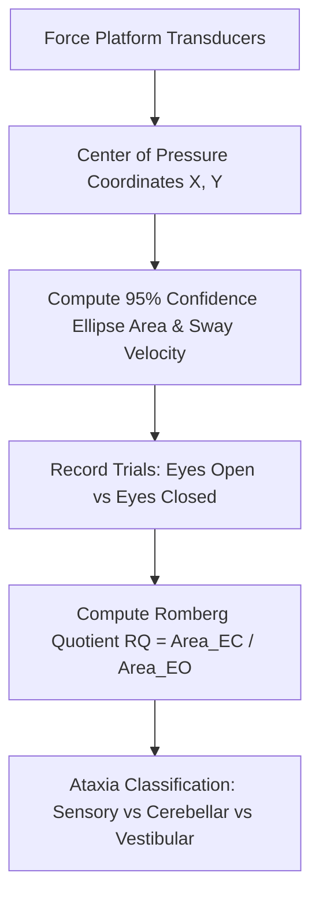

# Somatosensory Postural Sway & Center of Pressure (COP) Stabilometry Skill

[](LICENSE)
[](https://www.python.org/)
[](https://modelcontextprotocol.io/)
[](requirements.txt)
[](https://github.com/alphaparkinc)

A zero-dependency, mathematically rigorous personal agent skill that evaluates static postural stability, center of pressure dynamics, and sensory ataxia via Romberg force platform stabilometry.

## Architecture



## Quick Start

```python
from client import PosturalSwayStabilometryClient

client = PosturalSwayStabilometryClient()
result = client.evaluate_stabilometry(
    sway_area_eyes_open_mm2=115.0,
    sway_area_eyes_closed_mm2=205.0,
    sway_velocity_eyes_open_mm_s=8.2,
    sway_velocity_eyes_closed_mm_s=11.5
)
print("Romberg Quotient:", result["stabilometric_kinetics"]["romberg_quotient_area"])
print("Balance Status:", result["clinical_postural_assessment"]["balance_classification"])
```

## License
Apache-2.0
